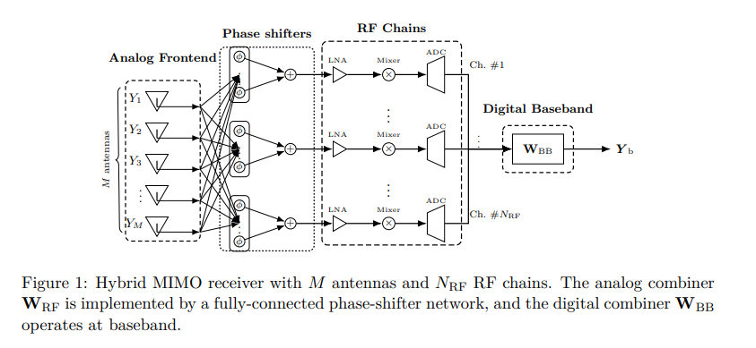
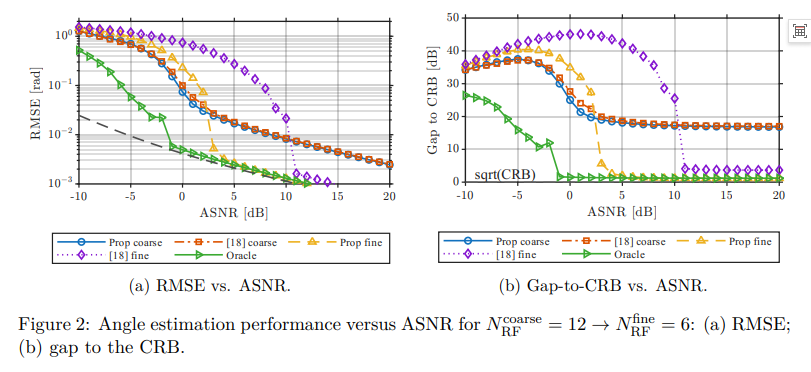
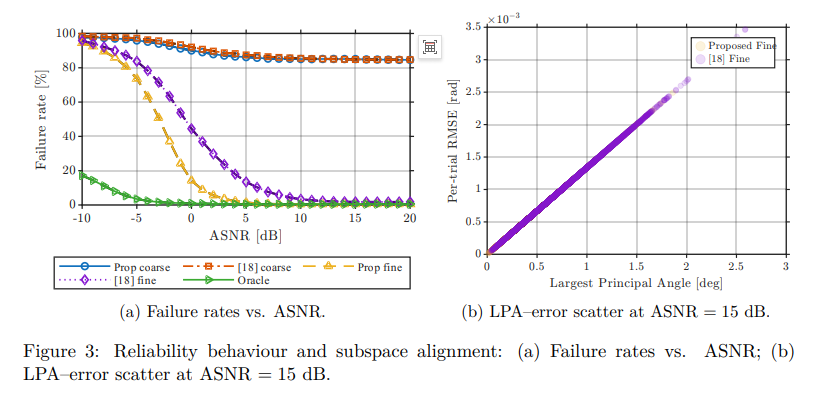
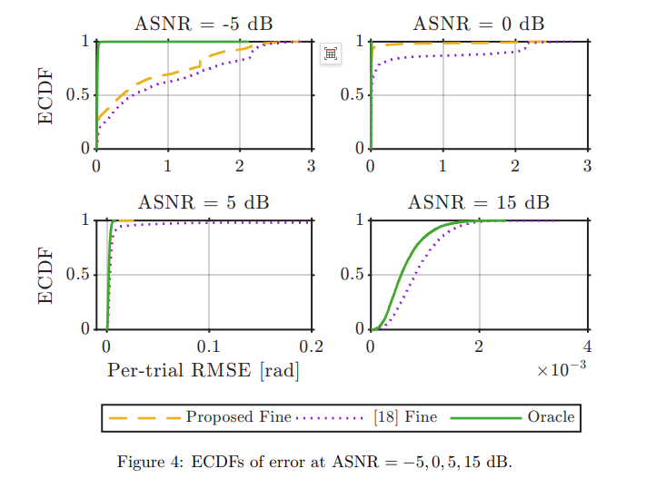
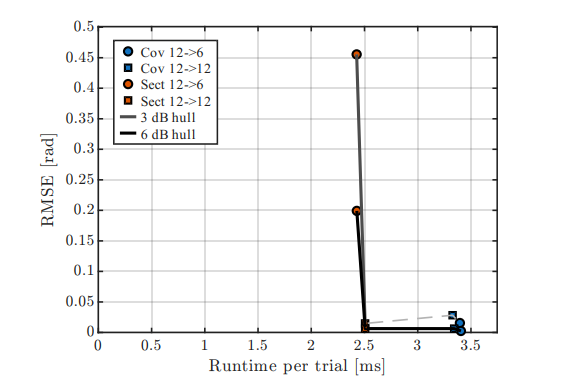
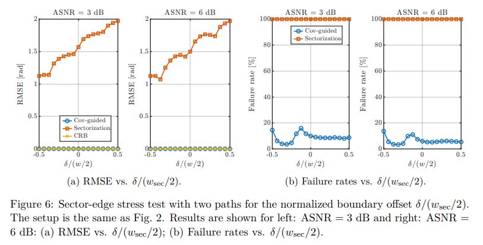
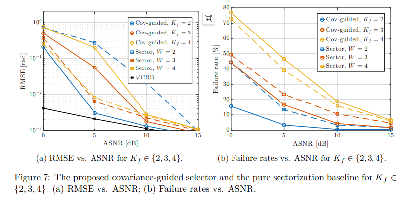

# Breakthrough Hardware Constraints: Covariance-Guided DFT Beamforming for High Accuracy DOA Estimation in 6G Mixed mmWave MIMO - A New Paradigm[With MATLAB Code]

Breaking Through Hardware Constraints: Covariance-Guided DFT Beam Selection for High Precision DOA Estimation in 6G Mixed mmWave MIMO - A Novel Paradigm
In the technological evolution of 6G and ultra-large antenna arrays, hybrid analog-digital (HAD) mmWave MIMO leverages its hardware advantages of "fewer radio chains and larger aperture" to become the core architecture for high bandwidth and high energy efficiency communication. However, the contradiction between limited radio chains and high precision direction of arrival (DoA) estimation has always been a key bottleneck restricting system performance.
Recently, a study published on arXiv titled "Covariance-Guided DFT Beam Selection for Beamspace ESPRIT in Hybrid mmWave MIMO Receivers," proposes a covariance-driven two-tier beam selection and superresolution estimation framework. It achieves near-CRB estimation accuracy under strict radio chain budgets, providing a theoretically sound and engineeringly viable new solution for air interface perception in hybrid architectures.
1. The Essence of the Problem: The Dilemma of DoA Estimation in Mixed mmWave MIMO
The mmWave frequency band suffers from large path loss and weak scattering, necessitating directional gain through large-scale antenna arrays; however, full digital MIMO is constrained by radio chain cost and power consumption, making the hybrid-analog architecture inevitable—simulation domain uses phase shifters for broadband beamforming, while digital domain completes low-dimensional baseband processing.
However, traditional solutions have three inherent flaws:
1. Information Utilization is Insufficient: Relying solely on coarse angle estimates or beam power without tapping into the signal subspace implied by covariance.
2. High Beam Redundancy: To counteract coarse estimate errors and sector edge effects, excessively activate beams, raising training overhead and computational burden.
3. Balanced Between Accuracy and Efficiency: Not quantifying the impact of beam modes, number of beams, and aperture reduction on ESPRIT accuracy, making it difficult to approach the theoretical lower bound under hardware constraints.
In summary: How to select optimal DFT beams with the least radio chain, achieving the highest resolution DoA estimation, is the central question this paper aims to address.
II. Core Innovation: Covariance-guided DFT Beam Selection + Sparse Beam Domain ESPRIT
This paper proposes a two-tier coarse-to-fine joint estimation architecture, using covariance fitting as the bridge to connect the entire link from "virtual subarray coarse estimation—full aperture covariance reconstruction—optimal continuous beam selection—sparse Unitary ESPRIT fine estimation," while maintaining low complexity and maximizing effective aperture.
2.1 System and Signal Model Array: M-element uniform linear array (ULA), d far-field narrowband uncorrelated sources
Hybrid Architecture: N_RF parallel RF chains (N_RF≪M), analog combiner selected from M-point DFT codebook
Observation Model: Beam domain signals are projected by the hybrid combiner, with the covariance containing both signal and noise components
Core Constraints: The number of RF chains is fixed, the selected beams must be continuous, and they must satisfy ESPRIT invariance.
2.2 First Level: Virtual center-symmetric subarray coarse ESPRIT does not directly use the full array but synthesizes a virtual center-symmetric subarray. It maps the mixed measurements to equivalent full digital subarray data through baseband combiners, and obtains coarse spatial frequency estimates through standard ESPRIT.
Utilizes center symmetry structure for forward and backward averaging, enhancing robustness against correlated sources
Low complexity, short training overhead, providing prior angle information for subsequent fine estimation
2.3 Key Breakthrough: Topolitz—Semidefinite Covariance Fitting based on coarse estimation completes two key operations:
1  
Source power and noise variance estimation: Builds a parameterized covariance model, solves nonnegative least squares (NNLS)
2  
Full aperture denoising covariance reconstruction: Projects the model covariance into the Hermitian Topolitz semidefinite cone to obtain denoised, structured full aperture signal covariance, serving as a "precise map" for beam selection.
This step is the essence of this paper compared to traditional sector division and beam scanning: replacing single-point estimation with data-driven structured covariance to achieve noise suppression and information enhancement.
2.4 Second Level: Covariance-guided Optimal Continuous DFT Beam Selection in the coarse estimation defined angle sector, using covariance capture degree + numerical robustness as the scoring criterion, selecting the optimal continuous K_g DFT beams under the beam budget constraint:
Capture score: Measures the degree to which beamforming subspace preserves signal covariance.
Condition number penalty: suppressing malfunctioning beam sets to ensure stable ESPRIT solution
Output: Each sector is a set of optimal continuous beams, forming a sparse but high-information beam set.
2.5 Precise Estimation: Sparse Beam Domain Unitary ESPRIT constructs sparse translation-invariant equations for the selected sparse continuous beam, and employs real-valued Unitary ESPRIT to achieve final DoA precise estimation.
Only one low-dimensional ESPRIT is needed, complexity determined by the RF budget.
Preserve the large effective aperture to achieve super-resolution performance close to CRB.
3. Performance verification: Approximate theory lower bound. Comprehensive overtaking of traditional solutions with 32-element ULA. 3 paths. 100 photos are for simulation settings. Baseline with sector-based partitioning Comparison of Ideal Predictor Beams. The core conclusions are as follows:
3.1 Estimation Accuracy: Close to the CRB-proposed refined estimation RMSE, closely follows the ideal pre-beam in the medium to high signal-to-noise ratio range, with a gap of only 1–2 dB between the CRB and this range.
The traditional sector division scheme requires an additional 4-6 dB signal-to-noise ratio to achieve similar precision.
Covariance-guided beams significantly enhance the information efficiency of each beam.
3.2 Robustness: Low signal-to-noise ratio and sector edge advantages can significantly reduce the failure probability to below 10% with a margin of 0–1 dB, while traditional solutions require 5–6 dB.
Sector edge pressure test: Traditional solutions experience a sharp increase in error at the boundary. The probability of failure is close to 100%. The scheme of this paper keeps low error and high reliability in full range. Prove that data-driven beamforming is insensitive to sector boundaries
3.3 Precision - Complexity Pareto Optimal Dynamic Radio Frequency Ablation Experiments indicate:
Cov 12→6 configuration achieves near CRB accuracy with minimal additional computational cost.
Under the same beam budget, this scheme has a higher accuracy than sector division; under the same accuracy, it has lower computational overhead.
Each sector requires only 2 beams to enter the high-performance range, providing a basis for dynamic resource allocation.
IV. Academic and Engineering Value: Foundation for 6G Air-Interface Perception 4.1 Theoretical Contributions
Establish a unified framework for covariance-guided beam selection and beam-domain ESPRIT, which is the first time to apply structured covariance fitting to DFT beam selection.
2  
Provide explicit construction of real-valued QP with Topolski-semidefinite projection, ensuring numerical stability and physical consistency.
3  
Reveal: A small number of optimal continuous DFT beams can be equivalent to a large aperture, and a hybrid architecture can approach the full-digital ESPArit performance.
4.2 Engineering enlightenment on the efficient use of RF chain: Fewer beams, larger aperture, reducing hardware costs and power consumption
Robust sector edge: alleviating the challenge of sector boundary alignment in mmwave deployment
Low complexity real-time implementation: only requires low-dimensional SVD and least squares, adapts to real-time processing at the terminal and base station.
Scalable: 2D/3D arrays, broadband near-field scenarios with direct scalability potential.
V. Future Evolution Directions
2D/3D Array Extension: Face-to-Face Array and Conformal Array, Azimuth-Elevation Joint Estimation
2  
Broadband near-field adaption: combining tensor ESPRIT, processing beam offset and distance dependence
3  
Robustness and anti-interference: Optimization for color noise, model mismatch, and strong interference scenarios
4  
Learning enhancement: Using the covariance fitting and beam selection in this paper as a teacher model, we develop a lightweight neural network beam selector to further reduce latency.
Conclusion In the wave of evolution towards "integrated sensing and communication" in 6G, the air interface ultra-resolution perception through hybrid millimeter-wave MIMO is a key link connecting communication with perception. The proposed covariance-guided DFT beam selection + sparse beam domain ESPRIT framework, backed by rigorous theory, low complexity implementation, and performance close to CRB, has solved the core contradiction of "limited radio frequency chain—high accuracy DoA estimation." It provides a feasible path for next-generation high-energy efficiency and high reliability millimeter-wave systems, both academically and practically valuable.

## Images

<!-- PAYMENT_BLOCK -->

## Get this dataset

- Payment link (Stripe): [Buy now](https://buy.stripe.com/3cs8yP7sY87d0vu9AB)
- Payment QR code: 

<!-- /PAYMENT_BLOCK -->
